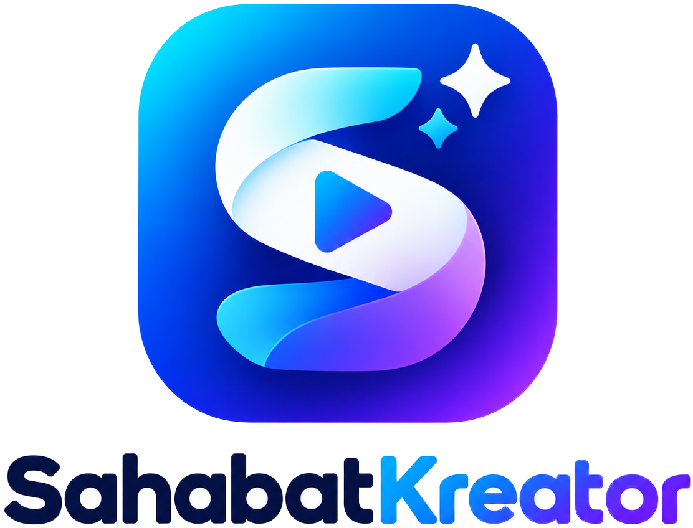

# Sahabat Kreator

<p align="center">
  
</p>

The open-source ManyChat alternative. Visual flow builder for Instagram, Facebook, Telegram & TikTok.

[](https://opensource.org/licenses/MIT)

## What is Sahabat Kreator?

Sahabat Kreator is an open-source alternative to ManyChat. Build visual chatbot flows, manage contacts, send broadcasts, run drip campaigns, and handle live chat conversations across Instagram, Facebook, Telegram, and TikTok.

### Features

- **Visual Flow Builder** - Drag-and-drop chatbot builder with 15+ node types
- **AI Response Node** - AI-powered replies via OpenAI, Anthropic, or Google (Vercel AI SDK)
- **Live Chat Inbox** - Real-time inbox with human takeover and conversation assignment
- **Contact CRM** - Tags, custom fields, segments, and contact management
- **Broadcasting** - Send targeted messages to contact segments
- **Sequences** - Drip campaigns with timed message series and automatic enrollment
- **Team Management** - Invite members, assign roles, manage permissions
- **Multi-Platform** - Instagram, Facebook, Telegram, TikTok
  - DMs, inbound webhooks, and comment replies are delivered through the messaging bridge. Rich content degrades to what each platform supports: buttons become URL buttons, while quick replies, carousels, and postback buttons are flattened into numbered text options.
- **Connect Channels** - OAuth connection flow directly from Sahabat Kreator; Telegram connects by QR session
- **Comment-to-DM** - Automatically DM users who comment specific keywords
- **Growth Tools** - Conversation starter links for each connected platform
- **A/B Testing** - Split test different message paths
- **Webhooks & HTTP** - Connect to external APIs from your flows

### Messaging bridge requirements

The messaging bridge gates parts of the API by plan. Sahabat Kreator needs:

| Feature | Minimum plan |
|---------|--------------|
| Inbound webhooks, comment replies | Standard |
| Chat inbox, content/private replies, OAuth connect | Gold |

Without the required tier, channel connection and message delivery fail with a provider API error.

## Quick Start

### Prerequisites

- Node.js 18+
- A [Supabase](https://supabase.com) project (free tier works)
- A [Repliz](https://repliz.com) account with an Access Key and Secret Key (entered in Settings after setup)
- A [Vercel AI Gateway](https://vercel.com/ai-gateway) key (optional, for AI node, entered in Settings or env)

### Setup

1. **Clone the repo**

```bash
git clone https://github.com/sahabatkreatorcom/sahabat-flow.git
cd sahabat-flow
npm install
```

2. **Set up Supabase**

Create a free project at [supabase.com](https://supabase.com). Then run the SQL migrations in the Supabase SQL editor:

```bash
# Run every numbered file in supabase/migrations/ in order, 00001 upwards.
# 00017 adds the messaging provider secret key column; run it even on an
# existing database.
```

3. **Configure environment**

```bash
cp .env.example .env
```

Fill in your Supabase credentials:

```
NEXT_PUBLIC_SUPABASE_URL=https://your-project.supabase.co
NEXT_PUBLIC_SUPABASE_ANON_KEY=your-anon-key
SUPABASE_SERVICE_ROLE_KEY=your-service-role-key
CRON_SECRET=your-cron-secret              # For sequence processor + job scheduler
# AI_GATEWAY_API_KEY=...                  # Optional, for self-hosted (Vercel handles this automatically)
```

After starting the app, go to **Settings** to enter your Repliz Access Key and Secret Key, plus (optionally) an AI Gateway key. The same page shows the webhook URL and token to paste into Repliz.

4. **Run**

```bash
npm run dev
```

Open [http://localhost:3000](http://localhost:3000), sign up, and start building flows.

### Webhook

Repliz delivers events to `POST /api/webhooks/repliz?workspace=<workspace-id>`. Requests must carry the workspace token in the `x-token` header; Sahabat Kreator rejects anything else. The token is generated on the Settings page and stored as `workspaces.webhook_secret`.

Repliz does not retry deliveries, and events may arrive out of order, so the receiver records each delivery ID before processing and treats duplicates as no-ops.

### Scheduled jobs

Delayed flow steps, broadcasts and sequence steps are driven by two endpoints: `GET /api/cron/jobs` and `GET /api/cron/sequences`. Both want the `CRON_SECRET` value, either as `?key=<secret>` or as an `Authorization: Bearer <secret>` header, and both must be called roughly once a minute.

Vercel Cron cannot do that on the Hobby plan — it only allows a daily schedule and rejects anything faster at deploy time — so this repo has no `vercel.json` and the schedule lives in `.github/workflows/cron.yml` instead:

1. Push the repository to GitHub.
2. Under **Settings → Secrets and variables → Actions**, add a secret `CRON_SECRET` with the same value the deployment uses.
3. On the same page, add a variable `APP_URL` holding the deployed origin, for example `https://sahabatkreator.com`.

The workflow then calls both endpoints every five minutes. That is the shortest interval GitHub supports, and its scheduler can drift under load, so for a tighter loop point an external cron at the same two URLs with the `Authorization` header — cron-job.org runs one-minute schedules on its free tier. Running both is safe: the handlers claim jobs with a compare-and-set, so overlapping callers cannot process the same job twice.

On a Vercel Pro plan you can drop the workflow and put the `crons` array back in a `vercel.json`; Vercel sends the `Authorization: Bearer <CRON_SECRET>` header for you once the env var is set.

## Architecture

```
Browser (Flow Builder, Inbox, CRM, Sequences)
        |
   Next.js App Router
        |
   +----+----+----+----+----+
   |    |    |    |    |    |
Webhook Flow CRM  Live  Broadcast Sequence
Recv.  Engine     Chat           Processor
   |    |    |    |    |    |
   +----+----+----+----+----+
        |         |         |
    Supabase   Repliz API  AI SDK
  (PG + Auth  (4 platforms) (OpenAI /
  + Realtime)              Anthropic /
                           Google)
```

## Stack

| Layer | Tool |
|-------|------|
| Framework | Next.js 16 (App Router, Turbopack) |
| Database + Auth + Realtime | Supabase |
| Flow Builder | React Flow (@xyflow/react) |
| AI | Vercel AI SDK + [AI Gateway](https://vercel.com/ai-gateway) |
| UI | Tailwind CSS 4 |
| Icons | @icons-pack/react-simple-icons |
| Messaging | [Repliz API](https://docs.repliz.com/api/introduction.html) |

## Flow Node Types

| Node | Description |
|------|-------------|
| Trigger | Keyword, postback, quick reply, welcome, default |
| Send Message | Text, images, buttons (URL buttons where supported) |
| AI Response | AI-powered replies with conversation context (OpenAI, Anthropic, Google) |
| Condition | If/else on tags, fields, platform, variables |
| Delay | Wait seconds/minutes/hours/days |
| Add/Remove Tag | Manage contact tags |
| Set Custom Field | Set contact field values with variable interpolation |
| HTTP Request | Call external APIs, store responses |
| Go To Flow | Jump to another flow (with return stack) |
| Human Takeover | Pause automation, alert inbox |
| Enroll in Sequence | Add contact to a drip campaign |
| Subscribe/Unsubscribe | Toggle contact subscription |
| A/B Split | Randomly route contacts for testing |
| Smart Delay | Wait for user response or timeout |
| Comment Reply | Public reply to comments |
| Private Reply | Instagram/Facebook comment-to-DM |

## Project Structure

```
sahabat-flow/
├── app/
│   ├── (auth)/             # Login, register pages
│   ├── (dashboard)/        # Flows, inbox, contacts, sequences, settings
│   ├── invite/             # Team invite acceptance page
│   └── api/
│       ├── webhooks/repliz/ # Repliz webhook receiver
│       ├── cron/jobs/       # Job scheduler
│       ├── cron/sequences/  # Sequence step processor
│       └── v1/              # CRUD API routes
├── components/
│   ├── flow-builder/        # Canvas, nodes, panels
│   ├── inbox/               # Conversation list, thread, contact panel
│   ├── sequences/           # Sequence editor, enrollment list
│   ├── settings/            # Team management
│   └── ui/                  # Shared UI components
├── lib/
│   ├── supabase/            # Server/client/middleware
│   ├── repliz-client.ts     # Typed Repliz REST client
│   ├── repliz-message.ts    # Rich message -> Repliz payload
│   ├── repliz-webhook.ts    # Token + URL helpers
│   ├── channel-sync.ts      # Repliz accounts -> channels
│   ├── flow-engine/         # Engine, trigger matcher, platform adapter, AI node
│   ├── actions/             # Server actions (team, sequences, workspace)
│   └── types/               # TypeScript types
└── supabase/
    └── migrations/          # SQL schema + RLS policies (00001-00017)
```

## Contributing

Contributions are welcome! Please open an issue or submit a pull request.

## License

MIT
